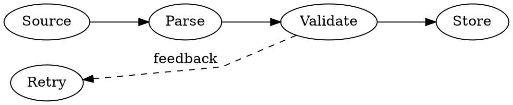

# Sphinx architecture diagrams

Use this skill when the requested document combines architecture structure with execution flow: entities such as components and artifacts, connected by the actual handoffs that run through a system. The goal is a readable, source-backed Sphinx page that explains both what the parts are and how data or control moves between them.

## Trace code before drawing it

Choose the smallest tracing tool that answers the diagram question; do not run all tools by default.

| Need | Evidence tool | What its edges establish |
|---|---|---|
| Classes, inheritance, packages | [pyreverse](https://pylint.readthedocs.io/en/latest/additional_tools/pyreverse/) | Static structural relationships |
| Function-call candidates | [code2flow](https://github.com/scottrogowski/code2flow) | Approximate static call relationships |
| Calls on one exercised scenario | [pycallgraph](https://pycallgraph.readthedocs.io/en/master/) | Observed runtime calls for that scenario |
| Cross-file concepts, dependencies, and paths | [graphifyy](https://pypi.org/project/graphifyy/) / `graphify` | Persistent graph relationships, tagged by provenance |

Static calls do not prove data movement or execution order. Missing runtime calls do not prove code is unreachable. Verify every claimed handoff against its source, direction, type, and applicable scenario before presenting it as a functional edge.

When `graphify-out/graph.json` exists, query or trace its relevant path first. Treat `EXTRACTED` edges as direct evidence and `INFERRED` or ambiguous edges as hypotheses to verify; refresh stale relevant paths before relying on them. Do not create a graph merely to document a small, local flow.

Before executing a tracer, check its interpreter and `--help`, record its command, version, scanned scope, and exclusions. For pycallgraph, first run an isolated compatibility smoke test: its upstream documentation describes version 1.0.1 from 2013, so record the actual package or fork and version that works with the target interpreter. Do not silently substitute a different tracer.

Typical focused commands are:

```text
pyreverse -o dot -p Project package
code2flow package -o calls.dot
pycallgraph graphviz -- ./scenario.py
```

Keep a raw, focused source diagram only as trace evidence. Collapse verified relationships into the existing Sphinx-Needs model so the needflow remains the canonical architecture view. Record source paths and lines, tracing provenance (`EXTRACTED`, `INFERRED`, or `AMBIGUOUS`), and runtime scenario beside the related needs.

## Build from evidence

1. Find the documentation setup and existing diagrams first. Extend an incumbent when it covers most of the need; avoid creating a second graph that repeats the same nodes and edges.
2. Trace the pipeline from source artifacts through builders, launchers, runtime inputs, batching, model or service initialization, execution, evaluation, and saved outputs. Follow the launcher arguments to the actual function defaults; a prepared dataset is not a training input unless the launch path passes it.
3. For each edge, verify both endpoints and the direction from source code or configuration. Record source paths beside the relevant needs so readers can audit the claim.
4. Separate observed implementation, prebuilt inputs, missing links, and proposed work. Show a gap or proposal explicitly when the requested path is absent. Do not invent unprovided search bounds, objectives, or runtime behavior.
5. If the source does not establish a handoff, leave the edge out or label the uncertainty. Do not make every artifact appear to feed every phase.

## Model the page with Sphinx-Needs

Keep one typed needs model as the canonical node-and-edge source. A useful starting vocabulary is:

- `component`: builder, launcher, batcher, loader, trainer, evaluator, or coordinator.
- `artifact`: source dataset, derived or synthetic data, evaluation set, checkpoint, adapter, or result.
- `gap`: a required or expected capability that has no live implementation.
- `proposal`: a requested future component or handoff that is not implemented.

Adapt the vocabulary to the system rather than adding types without a clear distinction. Add fields that make the diagram auditable, such as scope, status, source module, role, input/output contract, and evidence paths. Use stable, unique IDs that match the configured ID pattern.

Define link types in `needs_links` with human-readable outgoing and incoming labels. Choose edge direction consistently: artifact-to-consumer links make data movement easy to follow; component-to-artifact links can describe actions such as saving, scoring, or reporting. Avoid defining both directions for the same relationship unless they describe genuinely different actions, since reciprocal links create duplicate arrows.

Important Sphinx-Needs detail: register relationship names in `needs_links`, and list the relationship types to draw in `needs_flow_link_types` (or on each `needflow`). A declared relationship can validate while still being absent from the graph if the flow renderer is not configured to draw it.

## Organize the visual views

Render multiple views from the same needs rather than maintaining a second hand-authored diagram:

- A broad data-lineage view for acquisition, local sources, transformations, synthetic data, and downstream artifacts.
- One workflow view per major phase or subsystem, showing its actual inputs, batching, initialization, execution, evaluation, and output.
- An optimization or HPO view when trials, evaluation inputs, candidate settings, or missing sweeps cut across phases.
- A needtable or equivalent inventory for component contracts, implementation status, module paths, and evidence.

Use filters to keep each view legible. Include shared inputs and checkpoints explicitly when their scope falls outside the phase filter; otherwise a valid edge can disappear from the selected view. Prefer left-to-right flow for pipeline-like material. Use restrained type colors and make missing and proposed work visibly distinct, such as red gaps and dashed amber proposed links. Keep node text concise; put detailed contracts in need fields and the inventory.

## Apply ELK-informed layered layout conventions

Use ELK Layered's phases as a layout checklist: break cycles, assign layers, reduce crossings, place nodes, then route edges. These are design conventions here, not a claim that Sphinx or Graphviz is running ELK. Sphinx's `sphinx.ext.graphviz` invokes Graphviz; a DOT file does not execute ELK options. If an actual ELK renderer is used separately, name and version that renderer and keep its generated artifact distinct from Sphinx's DOT output.

For Sphinx-Needs `needflow` with the Graphviz engine, define a named `needs_graphviz_styles` profile and select it in the directive. Keep rank direction, spacing, and edge routing in the graph profile so diagrams share a predictable baseline:

```python
needs_graphviz_styles = {
    "layered": {
        "graph": {
            "rankdir": "LR",
            "ranksep": 0.8,
            "nodesep": 0.35,
            "splines": "polyline",
        },
        "edge": {"arrowsize": 0.7},
    }
}
```

```rst
.. needflow::
   :engine: graphviz
   :config: layered
   :direction: right
```

Treat the spacing values as starting points; inspect the rendered graph and tune them to its labels and node sizes. Confirm the installed Sphinx-Needs version supports the chosen options. Its `needs_graphviz_styles` accepts `root`, `graph`, `node`, and `edge` attributes; use `:engine: graphviz` so the selected Graphviz profile is actually applied.

For hand-authored DOT, keep the main data or control path flowing in one direction. Place true parallel stages on the same rank, and order edge declarations only when that order reflects the intended visual order. For a left-to-right graph, use east-side exits and west-side entries as the default; use named ports when a component has distinct inputs or outputs, and keep their order tied to those semantics. DOT supports `tailport` and `headport` for endpoints and named ports on record or HTML-like nodes. The generated `needflow` profile shown above does not set per-edge ports.



Use `minlen` only to give a real rank gap more room. Mark secondary or feedback edges `constraint=false` when they should not distort the main ranks. Use `ordering=out` only when DOT edge declaration order is meaningful; it constrains the order of a node's outgoing edges but does not remove semantic crossings. Keep distinct relationships as distinct edges; do not use edge concentration to hide or merge them.

Use `splines=polyline` or `splines=spline` when edges carry labels or connect through ports. Graphviz documents a limitation in `dot`: `splines=ortho` does not handle ports or edge labels. Orthogonal routing is therefore not a universal fix for overlapping arrows. Prefer short edge labels, adequate rank/node separation, meaningful rank constraints, and a smaller filtered view when routes still collide. Do not add dummy nodes or hub edges unless they represent real components or handoffs.

If a `needflow` view does not expose enough control to resolve a crossing, first split it into phase-specific views or use another view of the same needs. Keep a custom DOT diagram only for a concrete layout need that the canonical needs flow cannot express; never let visual routing change the source-backed relationship model.

References: [ELK Layered algorithm and phases](https://eclipse.dev/elk/reference/algorithms/org-eclipse-elk-layered.html), [Graphviz `dot`](https://graphviz.org/docs/layouts/dot/), [Graphviz edge ports](https://graphviz.org/docs/edges/), [Graphviz `splines`](https://graphviz.org/docs/attrs/splines/), and [Sphinx-Needs Graphviz styles](https://sphinx-needs.readthedocs.io/en/latest/configuration.html#needs-graphviz-styles).

## Configure and render

For a standalone page, keep the Sphinx configuration, pinned documentation dependencies, source page, and any small required stylesheet together. Configure Graphviz as a declared dependency and select it from `PATH`; add a platform-specific location only when the target environment requires it. Do not add a custom static Graphviz drawing that duplicates needflow relationships.

Build HTML with warnings treated as errors, for example:

```text
python -m sphinx -b html docs/architecture .tmp/architecture-html -W --keep-going
```

Adapt source and output paths to the repository. Then inspect the generated page and graph images. A successful build checks syntax and references, but not whether the picture communicates the right system.

Sphinx's built-in [`sphinx.ext.graphviz`](https://www.sphinx-doc.org/en/master/usage/extensions/graphviz.html) requires the system `dot` executable. Embed DOT evidence directly with `.. graphviz:: path/to/calls.dot`, or use `.. figure:: path/to/diagram.svg` (or PNG) for a rendered source diagram. SVG is supported for HTML output. For an Orange workflow, read [the Orange skill](../orange/SKILL.md) and document the saved workflow, its input data, and its evidence in the same provenance model.

## Review the rendered result

- Confirm IDs are unique and all links resolve; investigate every Sphinx or Sphinx-Needs warning.
- Check that expected handoffs produce visible arrows and their labels match the code behavior.
- Look for duplicate reciprocal arrows, isolated nodes that should connect, and edges that join the wrong phase or artifact.
- Verify shared checkpoints, trial-specific inputs, and launch defaults appear in the appropriate filtered view.
- Check graph size, node wrapping, contrast, and reading order in the rendered page, not only in the RST source.
- Inspect edge crossings, arrowhead overlap, labels colliding with routes, and feedback edges pulling nodes out of their main phase ranks; fix these through layer/order/spacing choices or narrower views.
- Reconcile known implementation gaps in both the graph and nearby explanatory text; never let prose imply a connection the graph does not show.

## Keep the deliverable focused

Use the repository's existing documentation conventions and spec process when present. Keep the page easy to build locally and link it from the project's docs index when one exists. Add a README, custom script, or extra reference only when the project has a concrete need for it.
