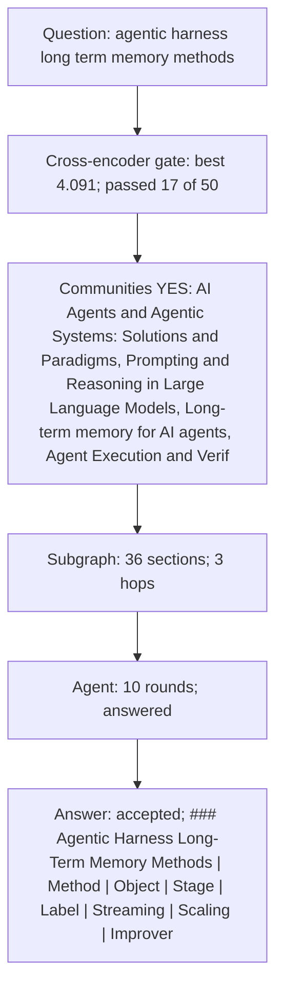

<!-- arxiv-retrieved-context -->
### Retrieved graph evidence

**Entities**

```toon
entities[6]{entity,sections}:
  long-term memory,15
  human memory,8
  Alex,8
  episodic memory,8
  hippocampus,6
  JOSH,6
```

**Communities**

```toon
communities[5]{community,sections,entities}:
  Long-term memory for AI agents,17,long-term memory (14); human memory (8); episodic memory (8); hippocampus (6)
  Research Papers and Technical Reports on AI Models,11,Alex (8); JOSH (6); Peter (7); LISA (6)
  Agent Execution and Verification Loop,6,harness evolution (5); Lee et al 2026 (3); harness Scaling (3); harness H (3)
  Fine-tuning LLMs for Reasoning and QA,1,no entity labels
  Acknowledgements of Support and Contributions,1,Kristina Toutanova (1); Kenton Lee (1); Ming-Wei Chang (1); Lopez (1)
```

**Retrieved sections**

23 papers; 38 passages. Expand a paper to inspect its source text.


### Model commentary

### Agentic Harness Long-Term Memory Methods
| Method | Object | Stage | Label | Streaming | Scaling | Improver Update | Evidence |
| :--- | :--- | :--- | :--- | :--- | :--- | :--- | :--- |
| Meta-Harness | Complete executable harnesses | Offline | External correctness | Not specified | Not specified | Retains search/diagnostic experience | [arxiv/2610_14224: A.1. Comparison Criteria (section 19)](https://arxiv.org/abs/2610.14224) |
| Agentic Harness Engineering (AHE) | Complete executable harnesses | Offline | External correctness | Not specified | Not specified | Retains diagnostic experience | [arxiv/2610_14224: A.1. Comparison Criteria (section 19)](https://arxiv.org/abs/2610.14224) |
| Test-Time Harness Evolution (TTHE) | Complete executable harnesses | Online (Batch) | Execution-derived proxies | Batch | Not specified | Not specified | [arxiv/2610_14224: A.1. Comparison Criteria (section 19)](https://arxiv.org/abs/2610.14224) |
| HarnessX | Modular primitives (prompts, tools, memory, control flow) | Online | Execution feedback | Not specified | Not specified | Not specified | [RRSI: Regularized Recursive Self-Improvement of Agent Harnesses: B. Baseline Methods (section 26)](https://arxiv.org/abs/2609.24972) |
| Harness 2 | Execution and Improvement harnesses | Online (Task-stream) | Label-free (behavioral contrasts) | Task-by-task | Parallel and sequential recursion | Updates improvement harness after each task | [arxiv/2610_14224: A.1. Comparison Criteria (section 19)](https://arxiv.org/abs/2610.14224) |
| MemoHarness | Harness edits | Offline/Online | Not specified | Not specified | Not specified | Builds diagnostic experience bank | [arxiv/2610_14224: A.1. Comparison Criteria (section 19)](https://arxiv.org/abs/2610.14224) |
| Adaptive Auto-Harness | Harness | Online | Delayed outcomes | Not specified | Not specified | Maintains cross-cycle improvement workspace | [arxiv/2610_14224: A.1. Comparison Criteria (section 19)](https://arxiv.org/abs/2610.14224) |
### Additional Retrieved Approaches
| Paper/method | Distinct contribution | Evidence |
| :--- | :--- | :--- |
| AtomMem | Organizes atomic facts into associative graphs for hierarchical retrieval; uses SFT-tuned Fact Executor for extraction. | [AtomMem: Building Simple and Effective Memory System for LLM Agents via Atomic Facts: 1 Introduction (section 2)](https://arxiv.org/abs/2606.19847) |
| MIRIX | Six-component memory architecture (Core, Episodic, Semantic, Procedural, Resource, Knowledge Vault) with active retrieval. | [MIRIX: Multi-Agent Memory System for LLM-Based Agents: 1 Introduction (section 2)](https://arxiv.org/abs/2507.07957) |
| Reflexion | Reflective learning: reflects on success/failure reasons semantically based on task feedback to enhance decision-making. | [Towards Large Reasoning Models: A Survey of Reinforced Reasoning with Large Language Models: 7.2 Memory-based Reinforcement (section 27)](https://arxiv.org/abs/2501.09686) |
| REMEMBERER | Experiential learning: semi-parametric RL-LLM agent using off-policy Q-learning to update Q-values of observation-action pairs in memory. | [Towards Large Reasoning Models: A Survey of Reinforced Reasoning with Large Language Models: 7.2 Memory-based Reinforcement (section 27)](https://arxiv.org/abs/2501.09686) |
| Memory Sharing | Multi-agent reinforcement learning: agents contribute high-quality prompt-answer pairs to a collective memory pool for few-shot learning. | [Towards Large Reasoning Models: A Survey of Reinforced Reasoning with Large Language Models: 7.2 Memory-based Reinforcement (section 27)](https://arxiv.org/abs/2501.09686) |
| Experiential Co-Learning | Multi-agent framework where Instructor/Assistant agents alternate providing instructions/solutions to extract shortcuts and prevent repetitive mistakes. | [Towards Large Reasoning Models: A Survey of Reinforced Reasoning with Large Language Models: 7.2 Memory-based Reinforcement (section 27)](https://arxiv.org/abs/2501.09686) |
| ExpeL | Combines imitation and reflection by retrieving successful experiences and summarizing patterns from success-failure comparisons. | [Towards Large Reasoning Models: A Survey of Reinforced Reasoning with Large Language Models: 7.2 Memory-based Reinforcement (section 27)](https://arxiv.org/abs/2501.09686) |
| RAHL | Hierarchical reinforcement learning: organizes memory into goal and sub-task modules for reflection at different levels. | [Towards Large Reasoning Models: A Survey of Reinforced Reasoning with Large Language Models: 7.2 Memory-based Reinforcement (section 27)](https://arxiv.org/abs/2501.09686) |
| Agent-Pro | Concept learning: establishes beliefs about self/environment in card games, evaluating rationality/consistency of beliefs. | [Towards Large Reasoning Models: A Survey of Reinforced Reasoning with Large Language Models: 7.2 Memory-based Reinforcement (section 27)](https://arxiv.org/abs/2501.09686) |
| Richelieu | Concept learning: retrieves relevant states from memory to formulate plans in military strategy games using self-play. | [Towards Large Reasoning Models: A Survey of Reinforced Reasoning with Large Language Models: 7.2 Memory-based Reinforcement (section 27)](https://arxiv.org/abs/2501.09686) |
| Self-Evolving GPT | Memory-based autonomous learning: categorizes tasks, identifies differences between stored memories and current tasks to extract general experience. | [Towards Large Reasoning Models: A Survey of Reinforced Reasoning with Large Language Models: 7.2 Memory-based Reinforcement (section 27)](https://arxiv.org/abs/2501.09686) |
| HDSO | Candidate validation: tests candidate skills by executing tasks twice (control vs. treatment) to prevent spurious shortcuts. | [The Last AI Built by Humans: Toward Genuine Recursive Self-Improvement: 3.5.3 Selective retention and deployment of updates (section 42)](https://arxiv.org/abs/2609.11873) |
| Metis | Candidate validation: text plans become executable code only after recurring across tasks and passing dependency/compilation checks. | [The Last AI Built by Humans: Toward Genuine Recursive Self-Improvement: 3.5.3 Selective retention and deployment of updates (section 42)](https://arxiv.org/abs/2609.11873) |
| Library Drift study | Library maintenance: append-only evidence log tracks skill contribution; skills retired when contribution fades; capped active skills. | [The Last AI Built by Humans: Toward Genuine Recursive Self-Improvement: 3.5.3 Selective retention and deployment of updates (section 42)](https://arxiv.org/abs/2609.11873) |
| Tax AI deployment | Governed deployment: practitioner corrections drive improvement; fixes arrive as pull requests for engineering review before release. | [The Last AI Built by Humans: Toward Genuine Recursive Self-Improvement: 3.5.3 Selective retention and deployment of updates (section 42)](https://arxiv.org/abs/2609.11873) |
| MemoryBank | Memory updating mechanism inspired by Ebbinghaus Forgetting Curve; forgets/reinforces memories based on time elapsed and importance. | [From Human Memory to AI Memory: A Survey on Memory Mechanisms in the Era of LLMs: 3.1.2 Memory Retrieval-Augmented Generation (Quadrant-II) (section 14)](https://arxiv.org/abs/2504.15965) |
| Reflective Memory Management (RMM) | Combines Prospective Reflection for dynamic summarization with Retrospective Reflection for retrieval optimization via RL. | [From Human Memory to AI Memory: A Survey on Memory Mechanisms in the Era of LLMs: 3.1.2 Memory Retrieval-Augmented Generation (Quadrant-II) (section 14)](https://arxiv.org/abs/2504.15965) |
| LD-Agent | Dynamic persona modeling module for users and agents to enhance long-term dialogue personalization. | [From Human Memory to AI Memory: A Survey on Memory Mechanisms in the Era of LLMs: 3.1.2 Memory Retrieval-Augmented Generation (Quadrant-II) (section 14)](https://arxiv.org/abs/2504.15965) |
| A-MEM | Self-organizing memory system inspired by Zettelkasten method; dynamic indexing, linking, and memory evolution. | [From Human Memory to AI Memory: A Survey on Memory Mechanisms in the Era of LLMs: 3.1.2 Memory Retrieval-Augmented Generation (Quadrant-II) (section 14)](https://arxiv.org/abs/2504.15965) |
| HippoRAG | Graph-based memory: constructs knowledge graphs over entities/phrases/summarization for comprehensive recall. | [From Human Memory to AI Memory: A Survey on Memory Mechanisms in the Era of LLMs: 3.1.2 Memory Retrieval-Augmented Generation (Quadrant-II) (section 14)](https://arxiv.org/abs/2504.15965) |
| ChatDB | Key-value memory retrieval using SQL queries over structured databases. | [From Human Memory to AI Memory: A Survey on Memory Mechanisms in the Era of LLMs: 3.1.2 Memory Retrieval-Augmented Generation (Quadrant-II) (section 14)](https://arxiv.org/abs/2504.15965) |
| RET-LLM | Fuzzy search to retrieve triplet-structured memories (entity-relation-entity). | [From Human Memory to AI Memory: A Survey on Memory Mechanisms in the Era of LLMs: 3.1.2 Memory Retrieval-Augmented Generation (Quadrant-II) (section 14)](https://arxiv.org/abs/2504.15965) |
| HARNESS-ZERO | Evolves student-side harness (tools, middleware, skills, memory) and adapts it into a private reference harness for trajectory collection. | [Harness-Zero: Harness Distillation via Agent-as-Harness: 3.1 Harness evolution and adaptation (section 8)](https://arxiv.org/abs/2609.24974) |
### Interpretation
The retrieved evidence distinguishes between **harness evolution methods** that optimize the external scaffold (prompts, tools, memory modules) of an agent and **memory management methods** that define how information is stored, retrieved, and updated within that scaffold.
**Harness Evolution and Memory as a Component:**
Automatic harness evolution treats memory as an editable component of the agent's infrastructure. Methods like **Meta-Harness** and **Agentic Harness Engineering (AHE)** optimize the full harness code, including memory configurations, using offline benchmark feedback [arxiv/2610_14224: A.1. Comparison Criteria (section 19)](https://arxiv.org/abs/2610.14224). **HarnessX** explicitly models memory as a modular primitive alongside prompts and tools, evolving it via trace-driven adaptation [RRSI: Regularized Recursive Self-Improvement of Agent Harnesses: B. Baseline Methods (section 26)](https://arxiv.org/abs/2609.24972). **Harness 2** introduces a recursive approach where both the execution harness and the improvement harness are updated in a label-free, task-by-task stream, using parallel and sequential recursion to refine memory and control flow without ground-truth labels [arxiv/2610_14224: A.1. Comparison Criteria (section 19)](https://arxiv.org/abs/2610.14224). **HARNESS-ZERO** evolves a student-side harness including memory components and adapts them into a reference harness for trajectory collection [Harness-Zero: Harness Distillation via Agent-as-Harness: 3.1 Harness evolution and adaptation (section 8)](https://arxiv.org/abs/2609.24974).
**Memory Management and Cognitive Architectures:**
Within these harnesses, long-term memory is implemented using various cognitive-inspired architectures. **AtomMem** uses atomic facts organized into associative graphs for hierarchical retrieval, addressing the bloat of raw conversation storage [AtomMem: Building Simple and Effective Memory System for LLM Agents via Atomic Facts: 1 Introduction (section 2)](https://arxiv.org/abs/2606.19847). **MIRIX** proposes a six-component memory system (Core, Episodic, Semantic, Procedural, Resource, Knowledge Vault) with active retrieval mechanisms [MIRIX: Multi-Agent Memory System for LLM-Based Agents: 1 Introduction (section 2)](https://arxiv.org/abs/2507.07957).
**Learning from Memory:**
Agents utilize stored memory for reinforcement and reflection. **Reflexion** and **ExpeL** employ reflective learning, where agents analyze past successes and failures to generate guidelines for future tasks [Towards Large Reasoning Models: A Survey of Reinforced Reasoning with Large Language Models: 7.2 Memory-based Reinforcement (section 27)](https://arxiv.org/abs/2501.09686). **REMEMBERER** uses experiential learning with Q-learning to update the value of observation-action pairs stored in memory [Towards Large Reasoning Models: A Survey of Reinforced Reasoning with Large Language Models: 7.2 Memory-based Reinforcement (section 27)](https://arxiv.org/abs/2501.09686). **MemoryBank** and **Reflective Memory Management (RMM)** incorporate forgetting mechanisms (e.g., Ebbinghaus curve) and dynamic summarization to maintain memory relevance [From Human Memory to AI Memory: A Survey on Memory Mechanisms in the Era of LLMs: 3.1.2 Memory Retrieval-Augmented Generation (Quadrant-II) (section 14)](https://arxiv.org/abs/2504.15965).
**Governance and Validation:**
To ensure stability, methods like **HDSO** and **Metis** validate proposed memory/skill updates by testing them against control runs or requiring recurrence across tasks before admission [The Last AI Built by Humans: Toward Genuine Recursive Self-Improvement: 3.5.3 Selective retention and deployment of updates (section 42)](https://arxiv.org/abs/2609.11873). The **Library Drift study** highlights the need for lifecycle management, retiring skills when their contribution fades to prevent retrieval degradation [The Last AI Built by Humans: Toward Genuine Recursive Self-Improvement: 3.5.3 Selective retention and deployment of updates (section 42)](https://arxiv.org/abs/2609.11873).
Demonstrated results show that harness evolution can improve performance, but its benefits over simple test-time scaling (parallel sampling/sequential refinement) are not consistent across all benchmarks, particularly when evaluation tasks overlap with training tasks [Rethinking the Evaluation of Harness Evolution for Agents: 1 Introduction (section 2)](https://arxiv.org/abs/2607.12227). Memory-specific methods like AtomMem and MIRIX demonstrate improved retrieval precision and personalization in long-horizon tasks [AtomMem: Building Simple and Effective Memory System for LLM Agents via Atomic Facts: 1 Introduction (section 2)](https://arxiv.org/abs/2606.19847), [MIRIX: Multi-Agent Memory System for LLM-Based Agents: 1 Introduction (section 2)](https://arxiv.org/abs/2507.07957).

### How this was answered



### Subgraph

